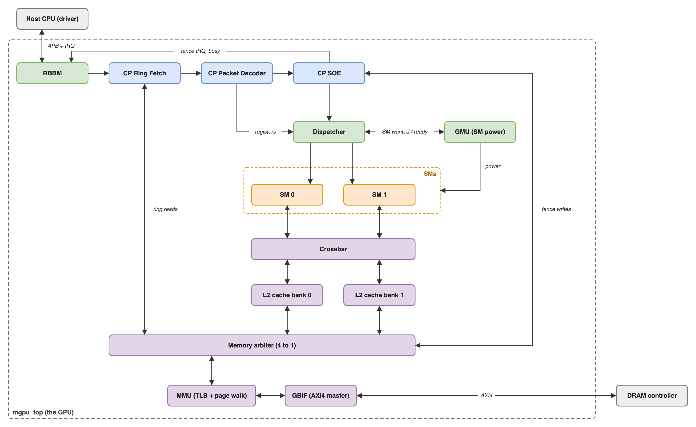
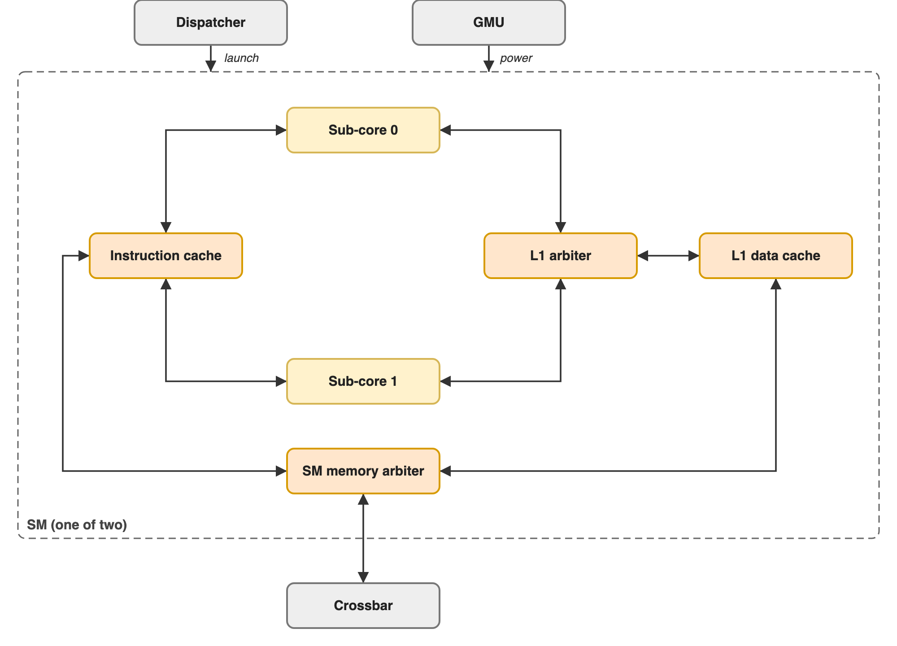
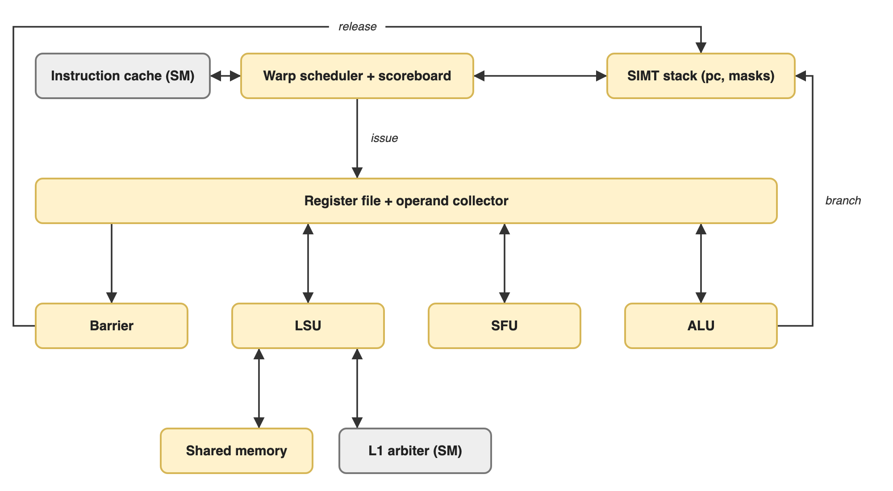

# mGPU

A small, basic GPU in SystemVerilog, written to show how a GPU works from the inside. Every block is small
enough to read in one sitting, and each one is verified on its own with UVM (Verilator 5 + UVM) before it joins
the full chip.

Size: 2 SMs, each with 2 sub-cores; each sub-core runs one workgroup of up to 4 warps of 8 threads.
A full-chip testbench drives the GPU like a driver (page tables, command ring, doorbell, interrupt) and compares
all of memory with an instruction-set simulator.

## How it works

1. The CPU (driver) writes commands into a ring buffer in memory and tells the GPU through RBBM registers (APB).
2. The command processor (CP) fetches the ring, decodes the packets, and the SQE runs them: register writes,
   kernel dispatches, fences and wait-for-idle.
3. The dispatcher splits a kernel into workgroups and launches them on free sub-cores; the GMU powers idle SMs down
   and wakes them when work arrives.
4. Inside a sub-core, the warp scheduler fetches and issues instructions; the register file sends operands to the
   ALU, SFU, LSU or barrier; the SIMT stack handles branches that split a warp.
5. Loads and stores go L1 -> crossbar -> L2 banks -> MMU (virtual to physical) -> GBIF -> AXI4 -> DRAM.
6. A fence write plus an interrupt tells the CPU the kernel is done.

## Block diagrams

Editable draw.io sources are in `docs/diagrams/` (open the `.drawio` files at app.diagrams.net).

**Whole chip**

**Inside one SM**

**Inside one sub-core**

## Block directory

| Block | Folder | What it does |
|---|---|---|
| CP packet decoder | `rtl/01_cp_packet_decoder` | Splits the PM4 command stream into register writes and operations for the SQE. |
| CP ring fetch | `rtl/02_cp_ring_fetch` | Reads command dwords from the ring buffer in memory and streams them to the decoder. |
| CP SQE | `rtl/03_cp_sqe` | Runs the operations: dispatch a kernel, write a fence (plus interrupt), wait for idle. |
| RBBM | `rtl/04_rbbm` | The CPU's register port (APB): ring pointers, interrupts, hang watchdog, perf counters, soft reset. |
| Dispatcher | `rtl/05_dispatcher` | Turns one kernel dispatch into workgroup launches on free sub-cores. |
| Instruction cache | `rtl/06_icache` | Direct-mapped cache of instructions, shared by the two sub-cores of an SM. |
| Warp scheduler | `rtl/07_warp_scheduler` | Fetches instructions per warp, tracks register hazards (scoreboard), issues one ready warp per cycle. |
| SIMT stack | `rtl/08_simt_stack` | Holds each warp's pc and active-thread mask; splits and rejoins a warp at divergent branches. |
| Register file + collector | `rtl/09_regfile_collector` | Banked registers for all warps; gathers operands and sends instructions to the right unit, takes write-backs. |
| ALU | `rtl/10_alu` | 8-lane integer math, logic, compares and branch decisions, one instruction per cycle. |
| SFU | `rtl/11_sfu` | Slow multi-cycle functions (divide, remainder) on 8 lanes. |
| Shared memory + barrier | `rtl/12_shared_mem_barrier` | Banked scratchpad shared by a workgroup's warps; barrier makes warps wait for each other. |
| LSU | `rtl/13_lsu` | Executes loads and stores; merges lanes that hit the same line into one memory request (coalescing). |
| L1 data cache | `rtl/14_l1_dcache` | 2-way data cache per SM, write-through; cleared at each new kernel. |
| SM | `rtl/15_sm` | Wraps 2 sub-cores, the I-cache, the L1 and the arbiters into one streaming multiprocessor. |
| Crossbar | `rtl/16_crossbar` | Routes each SM's memory request to the L2 bank that owns the address. |
| L2 cache | `rtl/17_l2_cache` | 2 banks, write-back, shared by all SMs; can be flushed by command. |
| MMU | `rtl/18_mmu` | Translates virtual to physical addresses with a TLB and 2-level page tables; reports faults. |
| GBIF | `rtl/19_gbif` | The GPU's bus interface: turns one 32-byte line request into one AXI4 burst. |
| DRAM controller | `rtl/20_dram_ctrl` | AXI4 slave in front of the memory array, with row-buffer hit/miss timing. |
| GMU | `rtl/21_gmu` | Powers idle SMs off after a timeout and wakes them when the dispatcher needs them. |
| Top | `rtl/22_mgpu_top` | Connects every block into the full GPU (`mgpu_top`) and adds DRAM (`mgpu_system`). |
| Shared definitions | `rtl/common` | ISA opcodes, sizes and helpers used by every block. |

## Layout

| Path | Contents |
|---|---|
| `rtl/<NN>_<block>/` | design of each block; `rtl/common/mgpu_pkg.sv` = ISA and sizes |
| `tb/<NN>_<block>/` | UVM testbench, `Makefile` (`make regress`, `make bugs`), `logs/` (per-test logs, text waveforms, merged coverage) |
| `tb/common/` | shared make rules, coverage bin counter, assembler, ISS, kernels |
| `uvm/` | the UVM library (Verilator port, Apache 2.0) |
| `scripts/` | log checker, coverage merge, `status.sh` (one line per block), `regress_all.sh` |
| `docs/modules/` | one PDF per block; `docs/mGPU_Design_and_Verification_Guide.pdf` = all of them |
| `docs/mGPU_RTL_Issue_Log.pdf` | every real RTL issue found during verification, why, fix, how it was caught, how to find such bugs |

Start with `docs/modules/00_mGPU_overview.pdf` (chip map, ISA, command stream, who talks to whom).

## Verification status

| Block | Regression | Merged coverage | Planted bugs caught |
|---|---|---|---|
| 01_cp_packet_decoder | 15/15 pass | 100.0% (28/28 bins) | 2/2 caught |
| 02_cp_ring_fetch | 18/18 pass | 100.0% (17/17 bins) | 2/2 caught |
| 03_cp_sqe | 18/18 pass | 100.0% (26/26 bins) | 3/3 caught |
| 04_rbbm | 24/24 pass | 100.0% (35/35 bins) | 3/3 caught |
| 05_dispatcher | 15/15 pass | 100.0% (20/20 bins) | 3/3 caught |
| 06_icache | 15/15 pass | 100.0% (14/14 bins) | 2/3 (BUG_FIXED_PRIO cannot fail in this system: see doc) |
| 07_warp_scheduler | 18/18 pass | 100.0% (15/15 bins) | 3/3 caught |
| 08_simt_stack | 15/15 pass | 100.0% (14/14 bins) | 3/3 caught |
| 09_regfile_collector | 12/12 pass | 100.0% (14/14 bins) | 2/2 caught |
| 10_alu | 9/9 pass | 100.0% (34/34 bins) | 3/3 caught |
| 11_sfu | 9/9 pass | 100.0% (14/14 bins) | 3/3 caught |
| 12_shared_mem_barrier | 9/9 pass | 100.0% (19/19 bins) | 5/5 caught |
| 13_lsu | 9/9 pass | 100.0% (15/15 bins) | 3/3 caught |
| 14_l1_dcache | 12/12 pass | 100.0% (13/13 bins) | 3/3 caught |
| 15_sm | 12/12 pass | 100.0% (19/19 bins) | 3/3 caught |
| 16_crossbar | 12/12 pass | 100.0% (14/14 bins) | 3/3 caught |
| 17_l2_cache | 15/15 pass | 100.0% (15/15 bins) | 4/4 caught |
| 18_mmu | 15/15 pass | 100.0% (14/14 bins) | 3/3 caught |
| 19_gbif | 12/12 pass | 100.0% (11/11 bins) | 3/3 caught |
| 20_dram_ctrl | 12/12 pass | 100.0% (15/15 bins) | 4/4 caught |
| 21_gmu | 12/12 pass | 100.0% (12/12 bins) | 3/3 caught |
| 22_mgpu_top | 14/14 pass | 100.0% (16/16 bins) | system level: block bugs verified in their benches |

`scripts/status.sh` regenerates this table from the logs.
